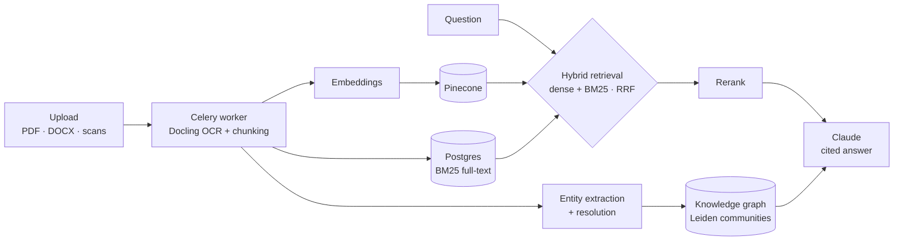

# Muhammad Umair

### Full-stack engineer who ships AI products to production, end to end.

React + TypeScript · Python + FastAPI · retrieval and ML pipelines · AWS · CI/CD. Six years shipping software for healthcare research, a global charity, a university AML research team and product startups. MSc Data Science.

[Portfolio](https://umairleo1.github.io/portfolio/) · [LinkedIn](https://www.linkedin.com/in/muhammad-umair-amin/) · [docnus.com](https://docnus.com) · [umair.leo17@gmail.com](mailto:umair.leo17@gmail.com)

> **Highlights**
> - **Designed, built and run a production AI SaaS on my own:** [Docnus](https://docnus.com), ~850 commits, 1,200+ automated tests, live in production with Stripe billing.
> - **Retrieval quality measured, not guessed:** 94% recall on a labelled golden set, regression-gated in CI.
> - **Impact in previous roles:** nightly ETL **45% faster** at UNICEF UK · release lead time **down 60%** and test coverage **55% → 85%** at SprintX · pipeline throughput **+30%** over 100 GB at the University of Greenwich.

---

## Now

**Software Engineer, NIHR Innovation Observatory, Newcastle University** (May 2026 – present)
Rebuilding a legacy ASP.NET MVC research database as a React 19 + TypeScript SPA on AWS: Cognito auth (authorisation code + PKCE, MFA), Lambda services behind API Gateway, GitHub Actions deploys to S3 + CloudFront. I designed the shared search / edit / merge screen kit that every section of the app is built on.

## Flagship: [Docnus](https://docnus.com)

Ask questions across your company's documents and get answers with citations. It's a multi-tenant SaaS, designed, built and operated solo, from database schema to deploy pipeline. (Source is private; happy to walk through it.)

**Engineering decisions I'm proud of**
- **Hybrid retrieval:** Pinecone vectors and Postgres BM25 merged by reciprocal-rank fusion, then reranked, so exact names and IDs aren't lost to semantic search.
- **Evaluation harness:** every tuned threshold is justified against a labelled golden set (94% recall, 0.69 nDCG@10). CI scores recorded runs against a committed baseline and fails on regression.
- **Isolated ingestion:** OCR runs in its own Celery worker container, so heavy documents never block the API and the worker scales independently.
- **Safe deploys:** each image is built once and promoted to production by immutable digest, never by a mutable tag, and main can't deploy on a red build.
- **Production basics done properly:** RBAC and per-plan quotas, Stripe billing with idempotent webhooks and event redrive, TOTP MFA for admins, PII detection and GDPR erasure, Prometheus and Sentry.

**Stack:** FastAPI · SQLAlchemy 2 (async) · PostgreSQL · Redis · Celery · Pinecone · OpenAI + Anthropic · React 19 · Redux Toolkit · Vite · Tailwind · Playwright · Docker · GitHub Actions

## Selected open source

| Project | What it demonstrates |
| --- | --- |
| **Nutrient Predictor** · [app](https://github.com/umairleo1/nutrient-predictor-frontend) · [API](https://github.com/umairleo1/nutrient-predictor-backend) · [model](https://github.com/umairleo1/nutrient-predictor-model-development) · [**live**](https://umairleo1.github.io/nutrient-predictor-frontend/) | ML taken all the way to product: NHANES preprocessing → calibrated XGBoost risk models → FastAPI service → React + TypeScript UI that explains each prediction. |
| [**subscription-tracker-backend**](https://github.com/umairleo1/subscription-tracker-backend) | Backend design: FastAPI with linked multi-account auth, Celery background jobs, Alembic migrations, Docker Compose. |
| [**currency-analysis**](https://github.com/umairleo1/currency-analysis) · [**live**](https://umairleo1-currency-analysis-app-l0fbth.streamlit.app/) | Data engineering: an exchange-rate pipeline with volatility and correlation metrics, served as an interactive Streamlit dashboard. |
| [**portfolio**](https://github.com/umairleo1/portfolio) · [**live**](https://umairleo1.github.io/portfolio/) | Release engineering: semantic-release, Lighthouse CI, Dependabot and PR quality gates on a React + TypeScript site. |

## Experience

| | |
| --- | --- |
| **NIHR Innovation Observatory** · Software Engineer · 2026– | React 19 + TypeScript SPA on AWS (Cognito, Lambda, API Gateway, S3, CloudFront), replacing a legacy ASP.NET MVC system. |
| **UNICEF UK** · Data Integrations Developer · 2025 | Salesforce → Snowflake ETL (Python, SQL, AWS Lambda) behind GitLab CI gates: **45% faster** nightly loads, **5M rows** reconciled at **99.8%** accuracy. |
| **University of Greenwich** · Software Developer (AI) · 2023–25 | LangGraph ML pipeline over **100 GB** (**+30%** throughput); SQL analytics **adopted by the AML research team**. |
| **SprintX** · AI Software Engineer · 2022 | React apps and CircleCI / Jenkins pipelines: release lead time **−60%**, coverage **55% → 85%**, production regressions **−40%**. |
| **Frizhub** · AI Software Engineer · 2020–21 | React Native apps and Dockerised AWS / GCP stacks with Terraform: deployment time **halved**, crash rate **−25%**. |

## Toolbox

**Languages** TypeScript · Python · SQL  
**Front end** React · TanStack Query · Redux Toolkit · Vite · Tailwind · shadcn/ui  
**Back end** FastAPI · SQLAlchemy · PostgreSQL · Redis · Celery  
**AI / data** RAG · Pinecone · OpenAI and Anthropic APIs · XGBoost · pandas  
**Cloud and delivery** AWS (Lambda, Cognito, API Gateway, S3, CloudFront, CDK) · Docker · Terraform · GitHub Actions · Vitest · Jest · Playwright · pytest

---

*Happy to talk about engineering, AI products or interesting roles. [Email me](mailto:umair.leo17@gmail.com).*
